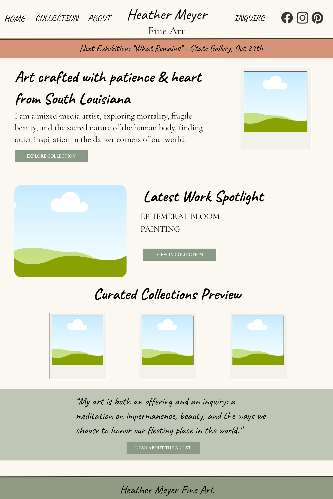
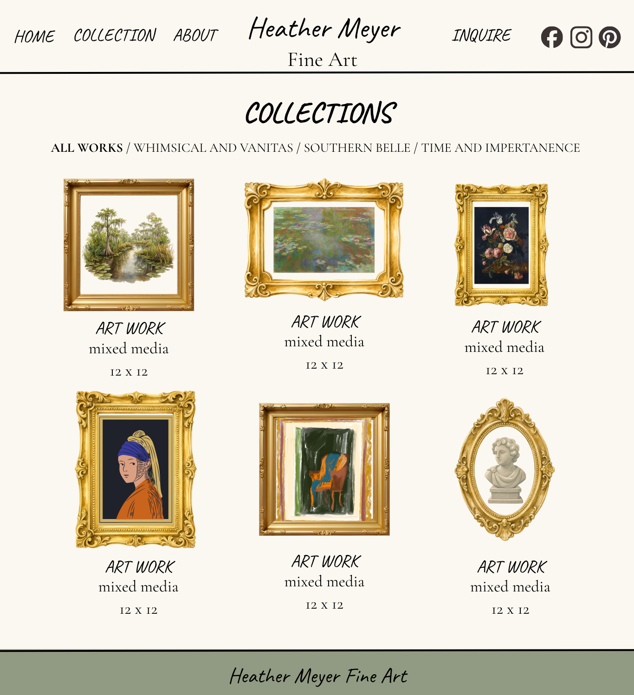
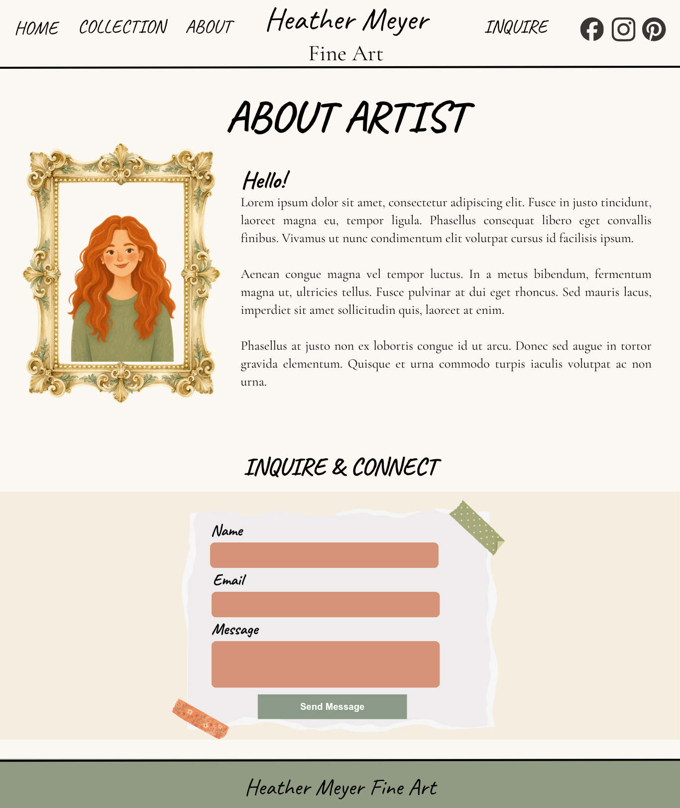

# Heather Meyer Fine Art

A personal web development project created to showcase the artwork, creative collections, and artistic journey of South Louisiana artist Heather Meyer.

The goal is to develop a visually engaging, responsive art portfolio alongside a secure content management system that allows the artist to independently manage her artwork and website content.

This project is both a collaborative passion project and an opportunity to expand my experience with React, backend development, database management, authentication, and full-stack application architecture.

## Project Goals

- Create an elegant, responsive portfolio that highlights the artist's work.
- Showcase featured artwork and curated collections.
- Provide visitors with information about the artist and upcoming exhibitions.
- Develop a private admin dashboard for managing website content.
- Implement secure authentication and role-based access control.
- Integrate Supabase for database management, authentication, and image storage.

## Current Features

### Public Website

- Responsive navigation with a mobile menu.
- Homepage hero section featuring an interactive artwork carousel.
- Featured artwork section.
- Curated collections preview.
- Artist introduction and call-to-action section.
- Upcoming event announcement banner.
- Responsive footer with dynamic copyright year.

### Planned Features

#### Public Website

- Artist biography and About page.
- Complete artwork gallery.
- Individual artwork detail pages.
- Collection filtering and browsing.
- Contact and artwork inquiry functionality.
- Dynamic artwork and collection content retrieved from Supabase.

#### Admin Dashboard

- Secure administrator login.
- Protected admin routes.
- Dashboard overview.
- Artwork creation, editing, and deletion (CRUD).
- Artwork image uploads.
- Collection creation and management.
- Featured artwork selection.
- Publish and draft controls.
- Event announcement management.
- Artist profile and website content management.

## Wireframes & Design

Before development, wireframes were created to establish the website's layout, visual direction, and overall user experience.

The design takes an editorial approach to showcasing fine art, combining warm neutral backgrounds, muted sage green accents, handwritten typography, and traditional gallery-inspired elements.

### Homepage

The homepage introduces the artist and highlights selected artwork and curated collections.

**Key design elements:**

- Artist branding and primary navigation.
- Upcoming exhibition announcement.
- Artist introduction and featured hero artwork.
- Latest artwork spotlight.
- Curated collection previews.
- Artist statement and footer.



### Collections Page

The collections page provides visitors with a gallery-style browsing experience.

**Key design elements:**

- Collection navigation and filtering.
- Artwork gallery grid.
- Artwork titles, mediums, and dimensions.
- Decorative artwork frames and gallery-inspired presentation.



### About Page



### Design Direction

The overall visual identity is inspired by traditional fine art galleries and editorial-style portfolios.

The design emphasizes:

- Warm, earthy, and neutral color palettes.
- Sage green and terracotta accents.
- Expressive handwritten display typography.
- Elegant serif typography for supporting content.
- Generous spacing and image-focused layouts.
- A responsive experience across desktop and mobile devices.

_Additional wireframes and design updates will be documented as the project progresses._

## Image Assets & Attribution

During the initial development phase, placeholder images sourced from [Unsplash](https://unsplash.com/) are being used to establish page layouts, test image placement, and refine the overall visual presentation.

These images are temporary and will be replaced with original artwork and photography provided by the artist as the website progresses.

Final artwork and artist photography will be incorporated with the artist's permission.

**Note:** Placeholder imagery does not represent the artist's actual portfolio or completed artwork collection.

## Technology Stack

### Frontend

- React
- Vite
- JavaScript
- Tailwind CSS
- CSS

### Backend (Planned)

- Supabase
- PostgreSQL
- Supabase Authentication
- Supabase Storage
- Row Level Security (RLS)

### Development Tools

- Git
- GitHub
- VS Code

## Project Structure

```text
src/
├── components/
│   ├── AboutCTA.jsx
│   ├── Banner.jsx
│   ├── CuratedCollection.jsx
│   ├── Featured.jsx
│   ├── Footer.jsx
│   ├── Hero.jsx
│   └── Navbar.jsx
│
├── App.jsx
├── App.css
├── index.css
└── main.jsx
```

_Project structure will evolve as additional pages, features, and backend functionality are introduced._

## Getting Started

### Prerequisites

- Bun
- Git

### Installation

1. Clone the repository:

```bash
git clone YOUR_REPOSITORY_URL
```

2. Navigate into the project directory:

```bash
cd YOUR_PROJECT_DIRECTORY
```

3. Install dependencies:

```bash
bun install
```

4. Start the development server:

```bash
bun run dev
```

5. Open the local development URL provided by Vite.

## Environment Variables

Supabase integration will require environment variables for the project URL and publishable key.

Example `.env` configuration:

```env
VITE_SUPABASE_URL=your_supabase_project_url
VITE_SUPABASE_PUBLISHABLE_KEY=your_supabase_publishable_key
```

**Important:** Never commit your `.env` file or expose Supabase secret/service-role keys in frontend code. Database security should be enforced using Row Level Security policies.

## Learning Objectives

This project provides an opportunity to strengthen my understanding of:

- Building reusable React components.
- Managing application state and component interactions.
- Working with relational databases and SQL.
- Integrating a backend service with a React frontend.
- Implementing authentication and authorization.
- Creating protected routes and admin interfaces.
- Managing file uploads and cloud storage.
- Performing CRUD operations.
- Applying database security through Row Level Security.
- Organizing and documenting a full-stack application.

## Project Status

**Currently in development.**

The initial homepage layout and reusable components have been implemented. Supabase integration, authentication, database functionality, and the admin dashboard are planned for upcoming development phases.

## Acknowledgments

Created as a collaborative passion project for Heather Meyer and as part of my continued growth as a full-stack developer.

- **Heather Meyer** — Artist, creative collaborator, and owner of the artwork featured in the portfolio.
- **Unsplash** — Source of temporary placeholder photography used during the initial design and development process.
- **Open-source community** — Appreciation for the tools, libraries, and resources that support the development of this project.

Artwork, artist photography, and creative content belong to their respective owners and are used with permission where applicable.

---

_Built with creativity, curiosity, and a love for learning._
